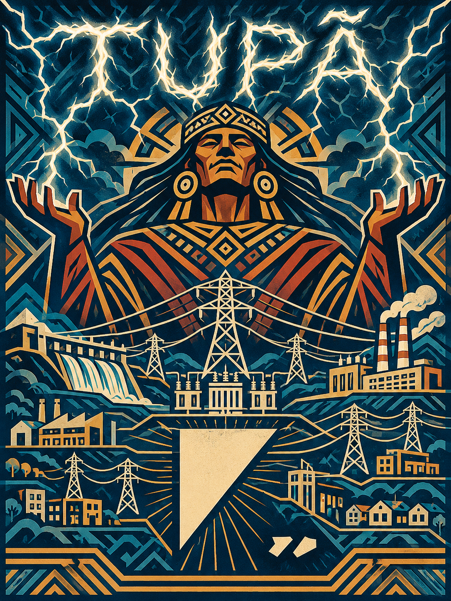

# TUPA⚡: Telemetría Unificada de Potencia Argentina

TUPA is a project aimed at aggregating and displaying the status of the
Argentine electrical grid, intended for feeding messaging bots and other
systems.

It is named after Tupã, the Guaraní spirit of lightning, thunder, and storms. ⚡

> 🇦🇷 A Spanish translateion of this document is maintained at [README-es.md](README-es.md).

## Philosophy

In priority order:

1. Security
2. Correctness
3. Limit necessary scope
4. Few or no dependencies

> TUPA is a broad aggregator, not an authoritative source. In mission-critical
> systems it should be treated as just another alert source, not a health
> indicator.

> Do one thing. Do it well.
>
> - Saint Doug of the House of McIlroy, scribe of the School of Unics in the Workshops of the Bell



## Design

TUPA runs standalone or from cron, writing JSON to stdout. Members are
selectable via named arguments, environment, or JSON configuration and default
to all. Each member combines several datasources and reports the worst known
status. The output can be used directly or piped to a file and served;
individual consumers are expected to know to select the members relevant to
them. See [doc/example.json](doc/example.json). In daemon mode, TUPA serves an HTML
dashboard at `/` and JSON at `/api`. The dashboard sources list shows only
sources active in the running instance.

Configuration: [doc/config.md](doc/config.md). Most users should not need to change
anything; defaults are intended to work. Normally only the listening address and
port (and occasionally the timezone, which defaults to Argentina Time) are
deployment settings.

### Run with Docker (recommended)

```sh
docker compose up --build --detach
```

`stack.env` is a template of all supported settings with their defaults commented
out. Optionally copy it to `.env`, then uncomment and change any values you need
before starting the container.

### Run from source

From `src/`:

```sh
cd src
python3 -m tupa
python3 -m unittest discover -s tests
```

From the repository root, `python3 -m pip install .` also installs a `tupa`
command.

### Releases

The version is declared once in `pyproject.toml`. After bumping it, create a Git
tag with the same `vX.Y.Z` value.

### Implemented sources

Edenor, Edesur and Edelap are supported through CAMMESA demand data, with ENRE
outage data for Edenor/Edesur and OCEBA outage data for Edelap. TUPA is an
automatable aggregator, not a replacement for independent monitoring services.

### Topology

Implemented upstream context lives in [doc/topology.md](doc/topology.md) and
[doc/diagram.pu](doc/diagram.pu).

### Status

A `member` carries a `status` (`operational`, `warn`, `high`,
`disaster`, or `unknown`), a `comment`, and an `updated` timestamp. Colors
(green, yellow, orange, red, grey) are display hints only. A `system` has its
own `updated` timestamp and a `members` map keyed by member name. Timestamps
are ISO 8601 / RFC 3339 strings. See the [CDDL schema](doc/status.cddl).

ENRE and OCEBA publish only a time of day in Argentina Time (ART); TUPA
reconstructs the date from upstream metadata or the current ART date and
normalizes every timestamp to the configured output timezone. See
[doc/config.md](doc/config.md) for details. Planned outages use the same severity
thresholds as any other outage.

## Contributing

- Send a properly reviewed pull request, or at least a well-thought-out issue.
- Write me a message on Nostr: [fred@hodl.ar](https://njump.me/fred@hodl.ar)
- Send me a coffee through the Lightning Network at `fred@lawallet.io`.

## License

Copyright (c) 2026 LU1AJR. Distributed under the
[BSD 2-Clause License](LICENSE).

The license covers TUPA's own code and documentation; data obtained from
upstream sources such as CAMMESA, ENRE, and OCEBA remains subject to its
respective terms.

## UGLY

* **ENRE TLS:** only legacy static-RSA TLS 1.2; TUPA uses `@SECLEVEL=1` for ENRE only, with certificate checks still on.
* **ENRE API(n't):** no API — data lives in generated `data_EDN.js` / `data_EDS.js`.
* **DNS trust:** TUPA uses the OS resolver and follows upstream redirects without filtering resolved addresses. Prefer a DNSSEC-validating resolver and restrict egress where that matters.
* **Schemaless endpoints:** TUPA defaults schemaless endpoints to HTTPS only; explicit `http`/`https` URLs are used as-is and other schemes are rejected.

